# Rapport — Installation et configuration d'Exchange Server 2019

**Chahd Merzaki**

← [Retour au README](README.md)

## Sommaire

1. [Prérequis](#1-prérequis)
2. [Préparation de l'Active Directory](#2-préparation-de-lactive-directory)
3. [Installation d'Exchange](#3-installation-dexchange)
4. [Configuration des bases de données](#4-configuration-des-bases-de-données)
5. [Création des boîtes aux lettres](#5-création-des-boîtes-aux-lettres)
6. [Groupe de distribution](#6-groupe-de-distribution)
7. [Salle de réunion](#7-salle-de-réunion)
8. [Configuration d'Outlook](#8-configuration-doutlook)
9. [Accès Web (OWA)](#9-accès-web-owa)
10. [Surveillance des services](#10-surveillance-des-services)

## Environnement

| Machine | IP | Système | Rôle |
|---|---|---|---|
| DC01 | 192.168.10.10 | Windows Server 2019 | AD DS + DNS, domaine `entrepriseCM.local` |
| EXCHANGE01 | 192.168.10.20 | Windows Server 2019 | Exchange Server 2019 CU14, rôle Mailbox |
| CLIENT01 | 192.168.10.30 | Windows 11 + Outlook | Poste client joint au domaine |

---

## 1. Prérequis

**DC01**

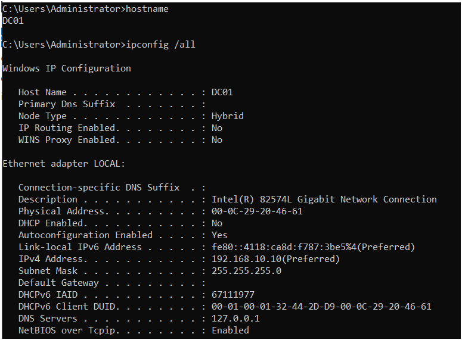

**EXCHANGE01** — même vérification côté Exchange (DNS pointant vers DC01).

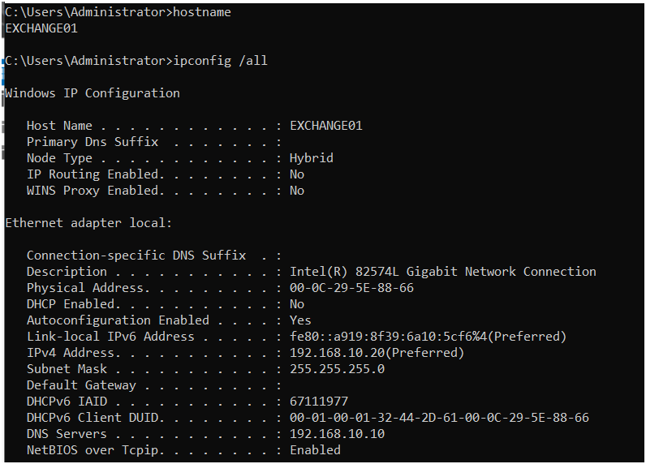

### 1.1 Rôles Windows via PowerShell

```powershell
Install-WindowsFeature RPC-over-HTTP-proxy, RSAT-Clustering, RSAT-Clustering-CmdInterface, `
  RSAT-Clustering-Mgmt, RSAT-Clustering-PowerShell, Web-Mgmt-Console, WAS-Process-Model, `
  Web-Asp-Net45, Web-Basic-Auth, Web-Client-Auth, Web-Digest-Auth, Web-Dir-Browsing, `
  Web-Dyn-Compression, Web-Http-Errors, Web-Http-Logging, Web-Http-Redirect, Web-Http-Tracing, `
  Web-ISAPI-Ext, Web-ISAPI-Filter, Web-Lgcy-Mgmt-Console, Web-Metabase, Web-Mgmt-Service, `
  Web-Net-Ext45, Web-Request-Monitor, Web-Server, Web-Stat-Compression, Web-Static-Content, `
  Web-Windows-Auth, Web-WMI, Windows-Identity-Foundation, NET-WCF-HTTP-Activation45

Add-WindowsFeature RSAT-ADDS-tools
```

- **RSAT-ADDS** est installé séparément : il fournit les outils AD nécessaires pour préparer le schéma (étape 2).
- **IIS (`Web-Server` et `Web-*`)** : OWA, l'EAC et Autodiscover sont des sites web. Sans IIS, rien ne fonctionne.
- **`*-Auth`** : les méthodes d'authentification qu'IIS doit gérer (utilisées notamment à la connexion à OWA).
- **`Web-Asp-Net45`, `WAS-Process-Model`, `Windows-Identity-Foundation`** : les applications web d'Exchange sont en ASP.NET.
- **`RSAT-Clustering-*`** : exigés par le rôle Mailbox même sans DAG, parce que le rôle est conçu pour pouvoir en faire partie plus tard. Sans eux, le setup échoue.
- **`RPC-over-HTTP-proxy`** : permet à Outlook de joindre le serveur en HTTP (rend l'étape 8 possible).

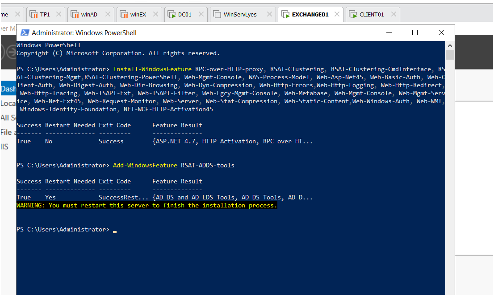

Redémarrage ensuite.

### 1.2 .NET Framework 4.8

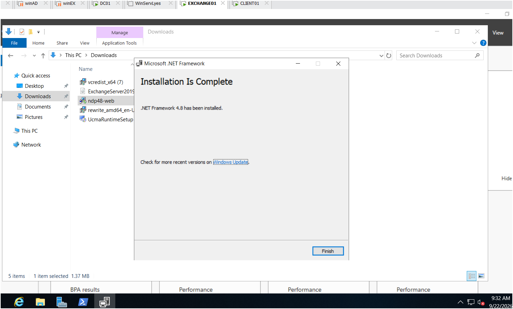

Après l'installation, un redémarrage est nécessaire pour que la nouvelle version soit prise en compte. Vérification :

```powershell
(Get-ItemProperty "HKLM:\SOFTWARE\Microsoft\NET Framework Setup\NDP\v4\Full").Release
```

Avant le redémarrage, la valeur est **461814** (.NET 4.7.2, la version de base de Windows Server 2019). Après :

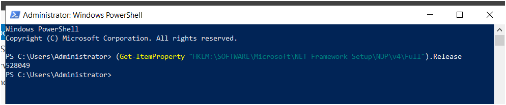

La valeur `Release` identifie la version exacte de .NET : **528040 ou plus = .NET 4.8**. Ajouter `.Release` à la commande affiche seulement cette valeur, ce qui est plus clair comme preuve que la clé de registre complète.

### 1.3 Composants Visual C++ et autres

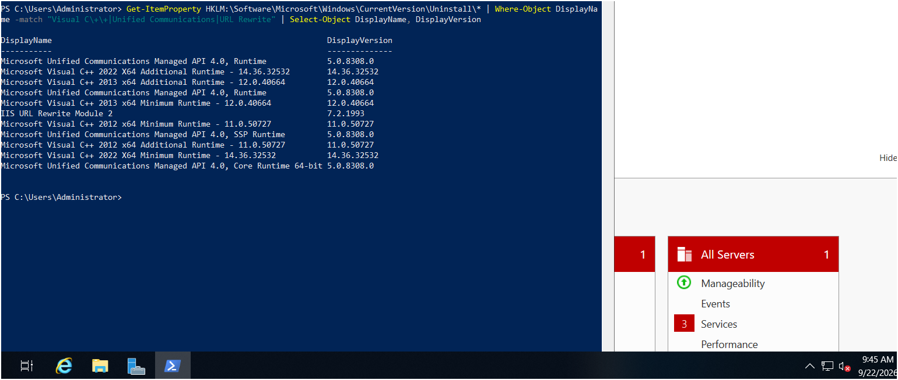

Visual C++ 2013 x64, UCMA 4.0 et IIS URL Rewrite sont installés.

### 1.4 Services Windows requis

```powershell
Get-Service W3SVC, WAS, WinRM | Select-Object Name, Status, StartType
```

- **W3SVC** : le service IIS, qui héberge OWA, l'ECP et Autodiscover.
- **WAS** : gère les pools d'applications d'IIS; W3SVC en dépend.
- **WinRM** : la gestion à distance PowerShell. L'EMS passe par WinRM même en local.

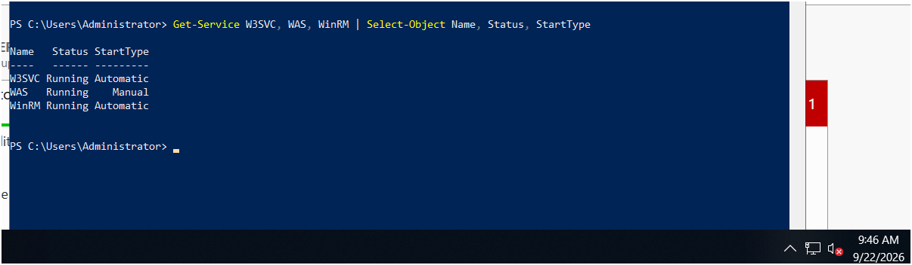

### Vue d'ensemble des fichiers d'installation

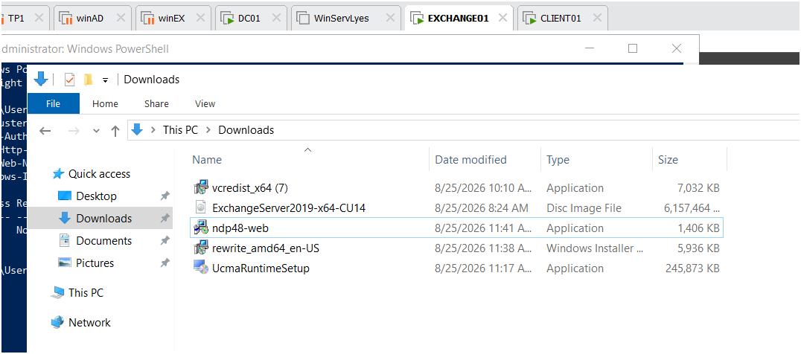

| Fichier | Rôle |
|---|---|
| ExchangeServer2019-x64-CU14 | ISO d'installation |
| ndp48-web | .NET Framework 4.8 |
| rewrite_amd64_en-US | IIS URL Rewrite |
| UcmaRuntimeSetup | UCMA 4.0 |
| vcredist_x64 | Visual C++ 2013 |

---

## 2. Préparation de l'Active Directory

AD DS est installé sur DC01 (`entrepriseCM.local`) et EXCHANGE01 est joint au domaine **avant** de préparer le schéma : la préparation modifie un domaine existant avec un compte du domaine.

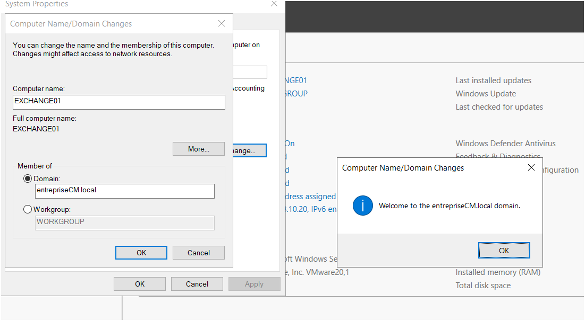

L'ISO d'Exchange est monté sur `E:`.

### 2.1 Préparer le schéma

```powershell
.\Setup.exe /PrepareSchema /IAcceptExchangeServerLicenseTerms_DiagnosticDataOFF
```

- **`/PrepareSchema`** : étend le schéma d'Active Directory (le schéma définit les types d'objets et les attributs qui peuvent exister). Exchange a besoin de nombreux attributs absents d'un AD de base, comme `msExchMailboxGuid`.
- **`/IAcceptExchangeServerLicenseTerms_DiagnosticDataOFF`** : accepte la licence et refuse l'envoi de données de diagnostic à Microsoft.

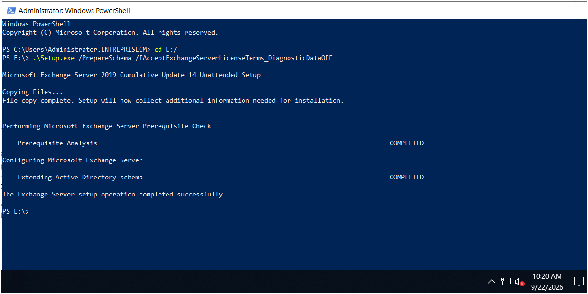

> **Remarque :** depuis la CU11 d'Exchange 2019, `/IAcceptExchangeServerLicenseTerms` seul ne suffit plus : il faut ajouter `_DiagnosticDataOFF` (ou `_DiagnosticDataON`), sinon le setup refuse de s'exécuter.

### 2.2 Préparer l'organisation

```powershell
.\Setup.exe /PrepareAD /OrganizationName:"ENTREPRISECM" /IAcceptExchangeServerLicenseTerms_DiagnosticDataOFF
```

- **`/PrepareAD`** : crée l'organisation Exchange dans la partition Configuration de la forêt, avec les groupes de sécurité et les conteneurs nécessaires. En entreprise, chaque domaine se prépare ensuite avec `/PrepareDomain`; ici la forêt n'a qu'un domaine, que `/PrepareAD` prépare directement.
- **`/OrganizationName`** : le nom de l'organisation Exchange, qui ne se donne qu'à la création.

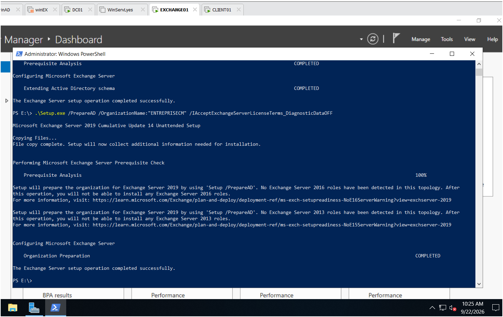

### 2.3 Vérification

Sur DC01 :

```powershell
Get-ADObject "CN=ms-Exch-Schema-Version-Pt,CN=Schema,CN=Configuration,DC=entrepriseCM,DC=local" -Properties rangeUpper
```

`ms-Exch-Schema-Version-Pt` est un attribut témoin créé par Exchange; sa valeur `rangeUpper` indique la version du schéma installée. Comme `rangeUpper` n'est pas affiché par défaut, il faut `-Properties`. La valeur **17003** confirme le schéma d'Exchange 2019 CU14.

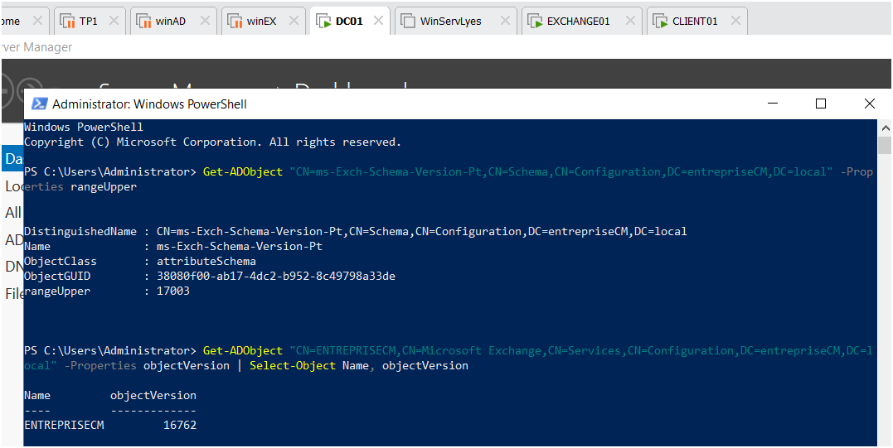

Les groupes de sécurité Exchange créés par `/PrepareAD` :

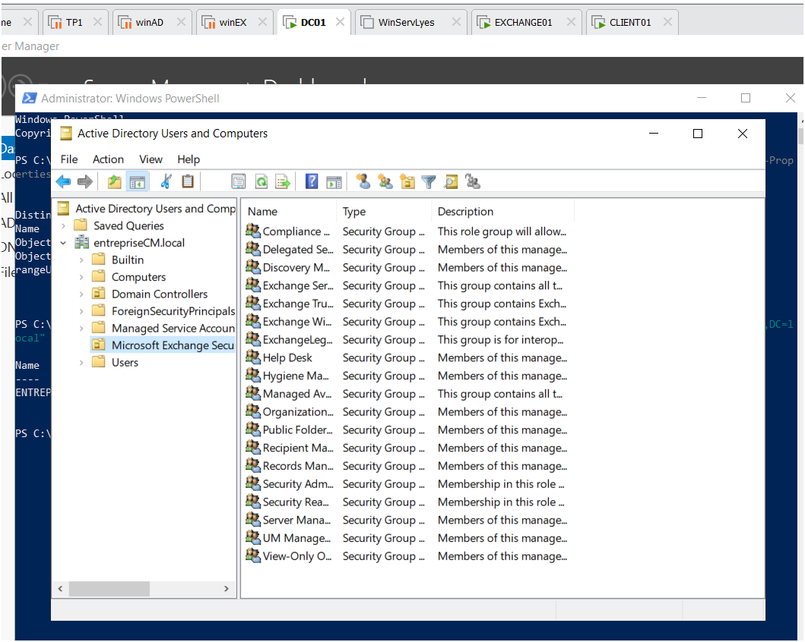

---

## 3. Installation d'Exchange

### 3.1 Installation en ligne de commande

```powershell
.\Setup.exe /Mode:Install /Roles:Mailbox /IAcceptExchangeServerLicenseTerms_DiagnosticDataOFF
```

- **`/Mode:Install`** : lance une installation (il existe aussi `/Mode:Uninstall` et `/Mode:Upgrade`).
- **`/Roles:Mailbox`** : installe le rôle Mailbox.

> **Remarque :** depuis Exchange 2016, le rôle Client Access n'existe plus séparément : il est intégré au rôle Mailbox.

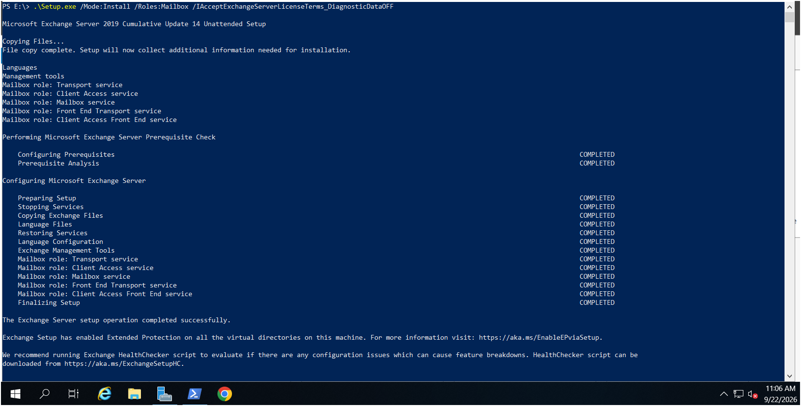

Redémarrage ensuite.

### 3.2 Espace d'adressage `entrepriseCM.local`

Le domaine AD s'appelant déjà `entrepriseCM.local`, l'espace d'adressage est configuré automatiquement à l'installation. Je l'ai vérifié dans l'EMS et dans l'EAC :

```powershell
Get-EmailAddressPolicy | Format-List Name, EnabledPrimarySMTPAddressTemplate
Get-AcceptedDomain
```

- **`Get-AcceptedDomain`** : les domaines pour lesquels Exchange accepte du courrier.
- **`Get-EmailAddressPolicy`** : la stratégie qui génère les adresses; le modèle `@entreprisecm.local` s'applique à toutes les nouvelles boîtes.

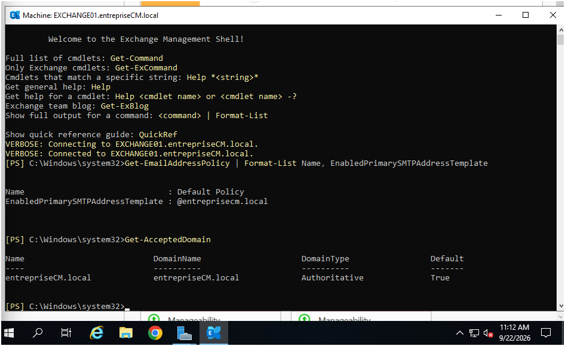

EAC → Flux de courrier → Domaines acceptés :

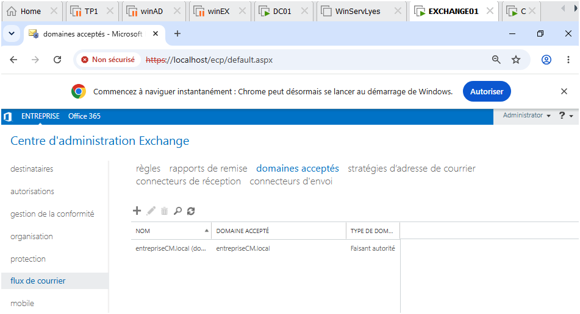

### 3.3 Vérification et journaux

```powershell
Get-ExchangeServer
```

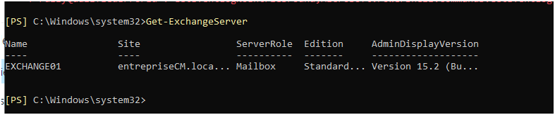

Les 30 dernières lignes de `C:\ExchangeSetupLogs\ExchangeSetup.log` :

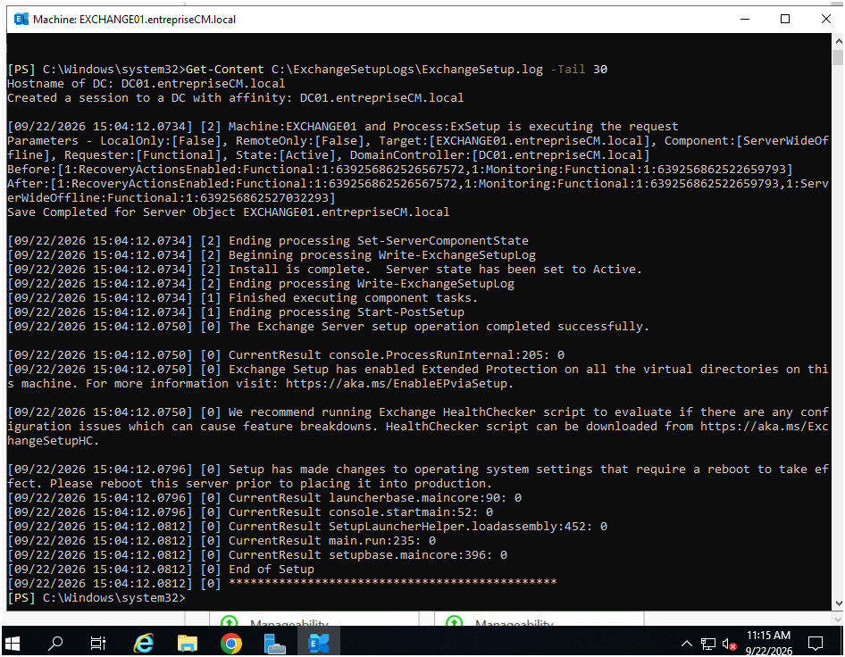

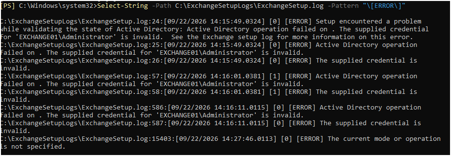

Les seules erreurs viennent de mes premières tentatives : j'étais connectée avec le compte administrateur **local**, d'où « The supplied credential is invalid ».

Tableau de bord de l'EAC :

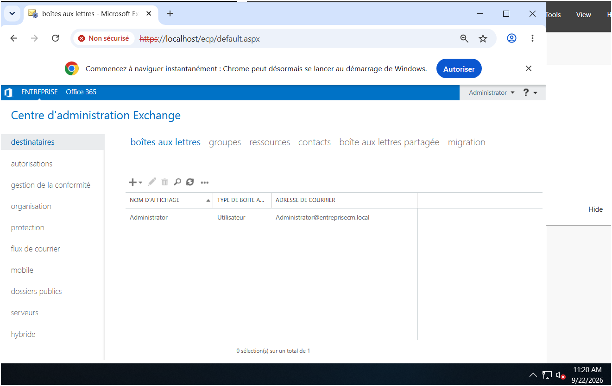

---

## 4. Configuration des bases de données

Avant de commencer, j'ai ajouté **un disque virtuel de 40 Go** en `E:`. Le chemin `E:\ExchangeDB` était imposé, et la lettre `E:` était occupée par l'ISO d'Exchange (qui se démonte au redémarrage).

### 4.1 Créer la base et son chemin

```powershell
New-Item -Path "E:\ExchangeDB\DB_ETUDIANTS" -ItemType Directory
```

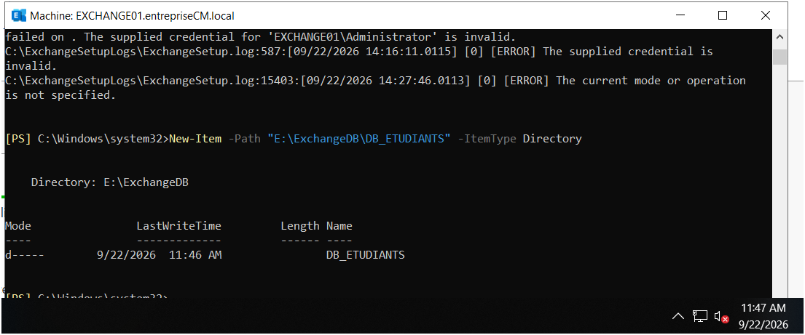

```powershell
New-MailboxDatabase -Name "DB_ETUDIANTS" -Server EXCHANGE01 `
  -EdbFilePath "E:\ExchangeDB\DB_ETUDIANTS\DB_ETUDIANTS.edb" `
  -LogFolderPath "E:\ExchangeDB\DB_ETUDIANTS\Logs"
```

- **`-EdbFilePath`** : le fichier `.edb`, qui contient les boîtes aux lettres.
- **`-LogFolderPath`** : les journaux de transactions. Exchange y écrit chaque modification avant de l'appliquer à la base, ce qui permet de récupérer les données après une panne.

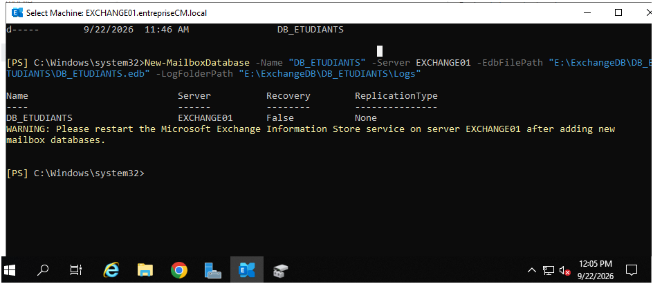

La base est créée, mais Exchange demande de redémarrer le service Information Store :

```powershell
Restart-Service MSExchangeIS
Mount-Database "DB_ETUDIANTS"
```

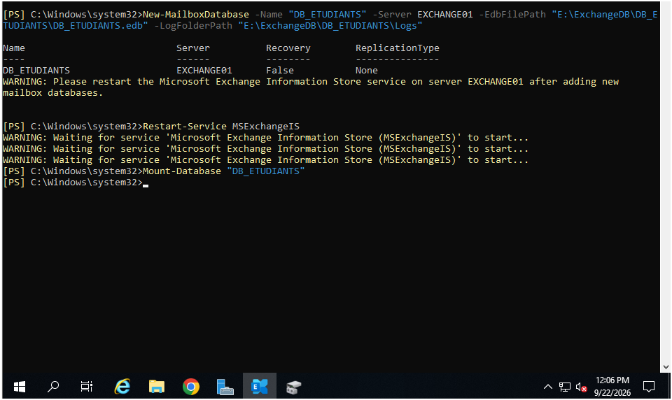

### 4.2 Quotas (1,5 Go) et rétention (12 jours)

```powershell
Set-MailboxDatabase "DB_ETUDIANTS" -IssueWarningQuota 1.3GB -ProhibitSendQuota 1.5GB `
  -ProhibitSendReceiveQuota 1.7GB -DeletedItemRetention 12.00:00:00
```

| Paramètre | Valeur | Effet |
|---|---|---|
| `IssueWarningQuota` | 1,3 Go | Avertissement à l'utilisateur |
| `ProhibitSendQuota` | 1,5 Go | Envoi bloqué |
| `ProhibitSendReceiveQuota` | 1,7 Go | Envoi et réception bloqués |
| `DeletedItemRetention` | 12 jours | Éléments supprimés récupérables (format `jours.heures:minutes:secondes`) |

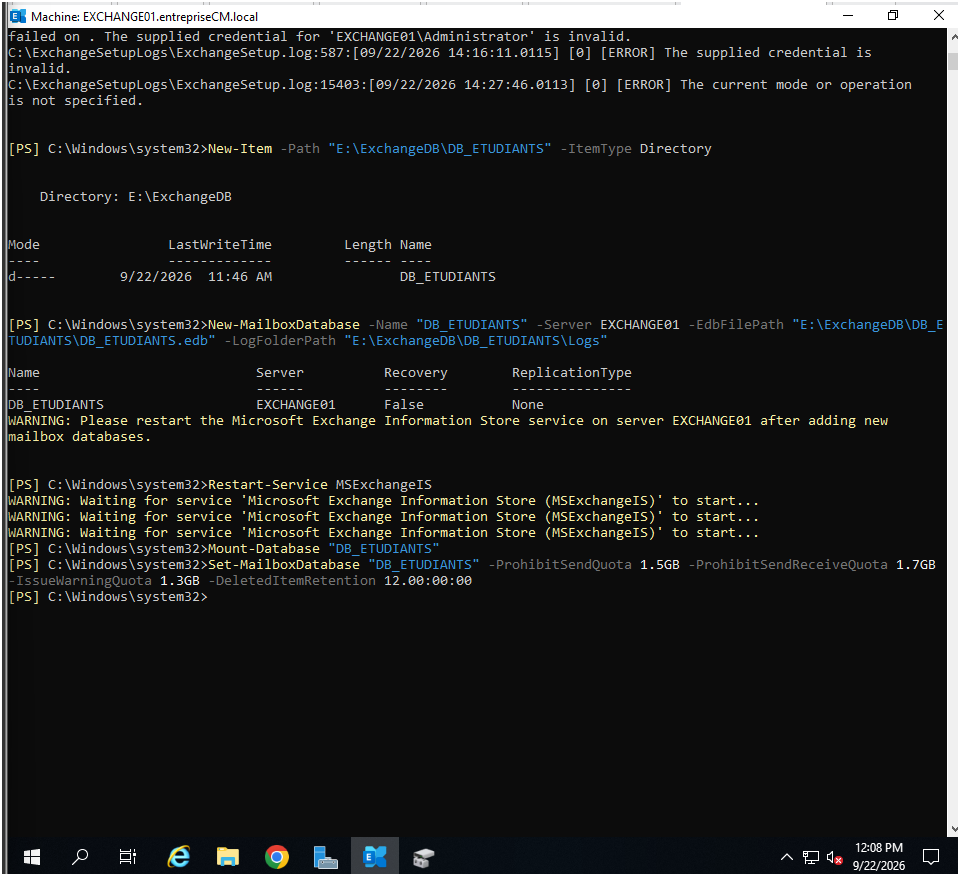

### Vérification

```powershell
Get-MailboxDatabase "DB_ETUDIANTS" -Status | Format-List Name, Server, Mounted, EdbFilePath, `
  LogFolderPath, IssueWarningQuota, ProhibitSendQuota, ProhibitSendReceiveQuota, DeletedItemRetention
```

`-Status` est nécessaire pour afficher `Mounted` : cet état n'est pas stocké dans AD, il est lu en direct sur le serveur.

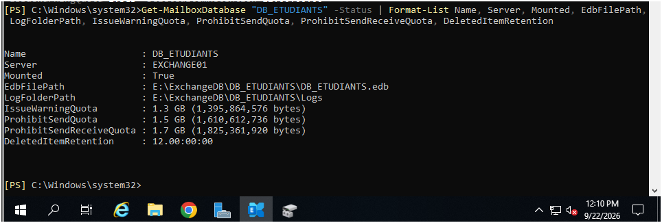

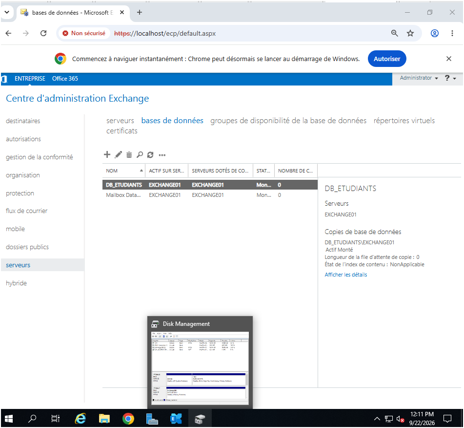

---

## 5. Création des boîtes aux lettres

```powershell
New-Mailbox -UserPrincipalName etudiant1@entrepriseCM.local -Alias etudiant1 `
  -Database "DB_ETUDIANTS" -Name "Etudiant1" -FirstName "Jean" -LastName "Dupont" `
  -Password (ConvertTo-SecureString -String 'Pa$$w0rd123' -AsPlainText -Force)
```

Même commande pour `etudiant2` et `professeur`.

- **`-UserPrincipalName`** : le nom de connexion, qui sert aussi d'adresse principale.
- **`-Alias`** : le nom court utilisé à l'interne par Exchange.
- **`-Password (ConvertTo-SecureString …)`** : Exchange exige un `SecureString`; `-AsPlainText` indique qu'on part d'un texte clair.

> **Remarque :** les **guillemets simples** sont importants. Avec des guillemets doubles, PowerShell interprète `$$` comme une variable et le mot de passe est modifié.

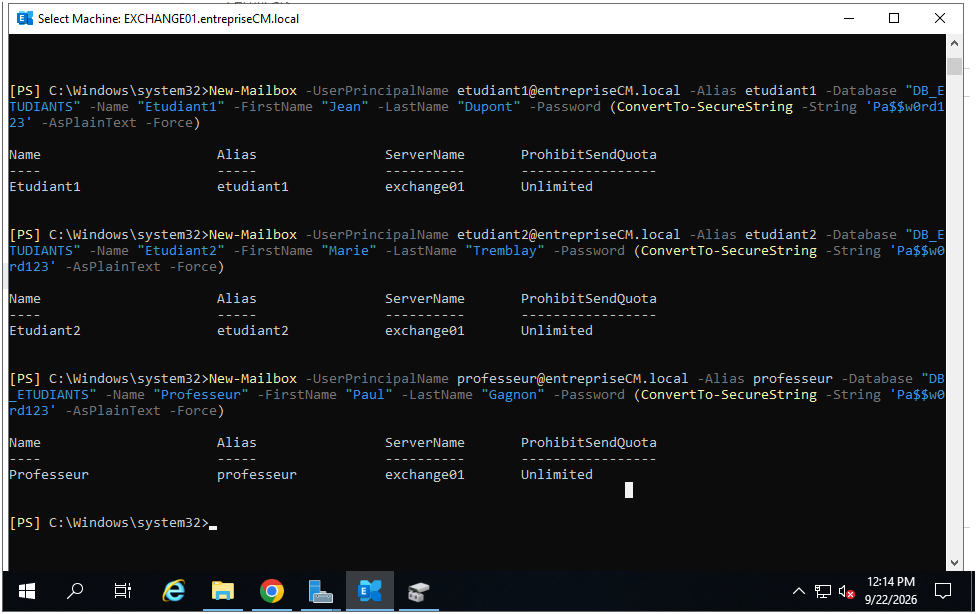

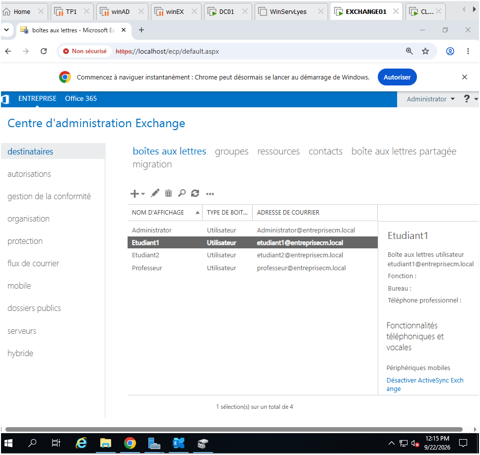

```powershell
Get-Mailbox
```

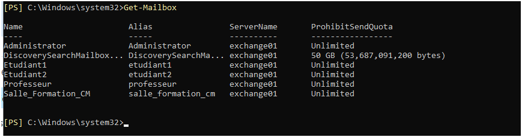

---

## 6. Groupe de distribution

### 6.1 Créer le groupe, ajouter les membres, adhésion ouverte

```powershell
New-DistributionGroup -Name "Etudiants_Promotion2024" -Alias "Etudiants2024" `
  -MemberJoinRestriction Open -ManagedBy "professeur"

Add-DistributionGroupMember -Identity "Etudiants_Promotion2024" -Member "etudiant1"
Add-DistributionGroupMember -Identity "Etudiants_Promotion2024" -Member "etudiant2"
```

- **`-Alias`** : donne l'adresse du groupe, `Etudiants2024@entrepriseCM.local`.
- **`-MemberJoinRestriction Open`** : n'importe qui peut rejoindre le groupe sans approbation.
- **`-ManagedBy`** : le propriétaire du groupe.

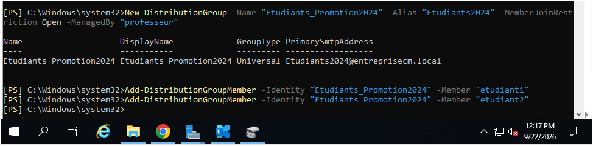

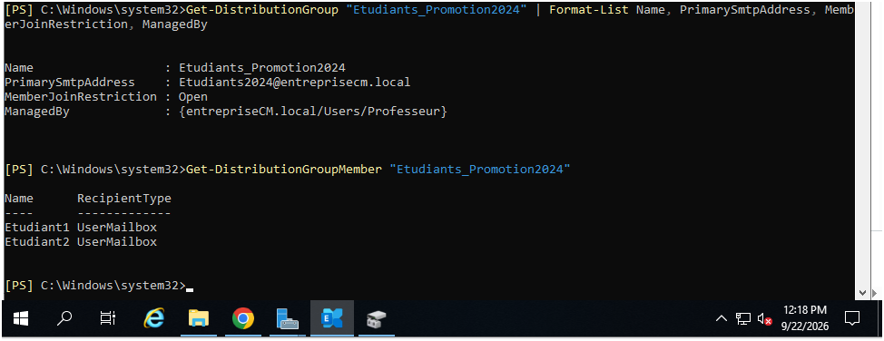

### 6.2 Test d'envoi au groupe

Connexion à OWA (`https://localhost/owa`) avec le compte `professeur`, envoi d'un message à l'adresse du groupe.

Le premier essai est resté bloqué dans les brouillons (« Nous ne sommes pas encore prêts à envoyer votre message »). **Cause :** avec deux cartes réseau, le serveur ne résolvait pas correctement son propre nom. Après désactivation de la carte Internet, l'envoi est passé.

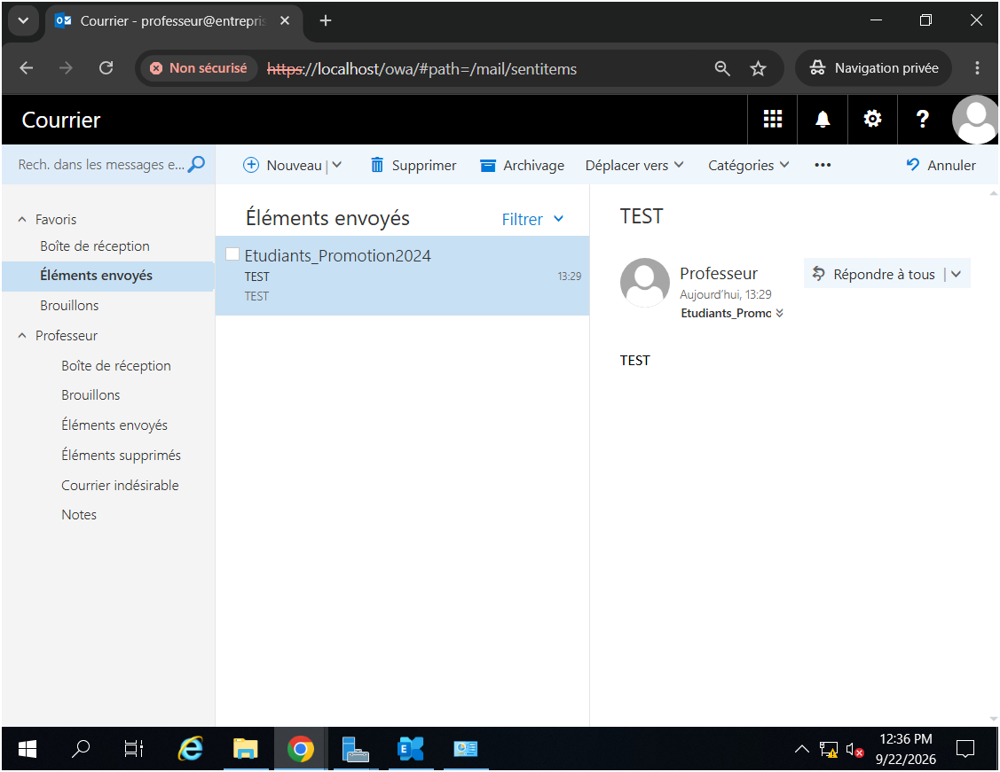

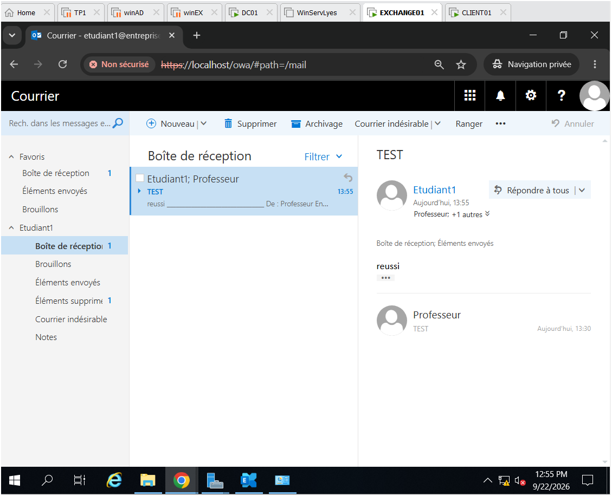

---

## 7. Salle de réunion

### 7.1 Boîte de type salle

```powershell
New-Mailbox -Room -Name "Salle_Formation_CM" -Alias "salle_formation_cm"
```

`-Room` crée une boîte de ressource; son compte AD est désactivé, puisque personne ne se connecte à une salle.

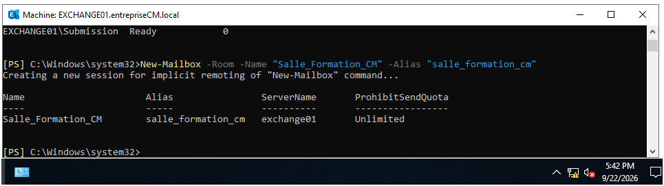

### 7.2 Heures de réservation (8 h à 18 h, lundi au vendredi)

```powershell
Set-MailboxCalendarConfiguration -Identity "Salle_Formation_CM" -WorkDays Weekdays `
  -WorkingHoursStartTime 08:00:00 -WorkingHoursEndTime 18:00:00 `
  -WorkingHoursTimeZone "Eastern Standard Time"
```

> **Remarque :** `-ScheduleOnlyDuringWorkHours` dit seulement « respecte les heures de travail », sans les définir. Sans `Set-MailboxCalendarConfiguration`, la salle garderait ses heures par défaut (**8 h à 17 h**).
> Source : [TheITBros — Set Working Hours in Outlook Calendar with PowerShell](https://theitbros.com/set-working-hours-in-outlook-calendar-with-powershell/)

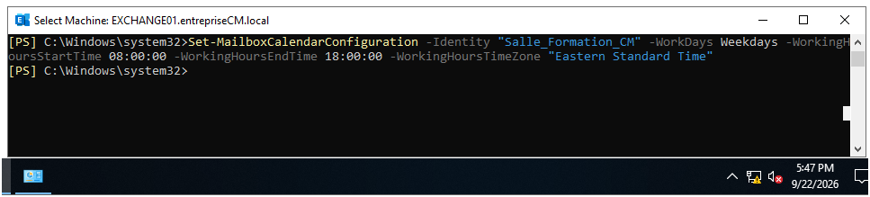

### 7.3 Réservation automatique

```powershell
Set-CalendarProcessing -Identity "Salle_Formation_CM" -AutomateProcessing AutoAccept `
  -ScheduleOnlyDuringWorkHours $true
```

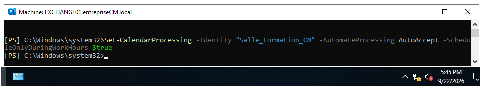

### Vérification

```powershell
Get-MailboxCalendarConfiguration "Salle_Formation_CM" | Format-List WorkDays, `
  WorkingHoursStartTime, WorkingHoursEndTime, WorkingHoursTimeZone
Get-CalendarProcessing "Salle_Formation_CM" | Format-List AutomateProcessing, `
  ScheduleOnlyDuringWorkHours, AllowConflicts
```

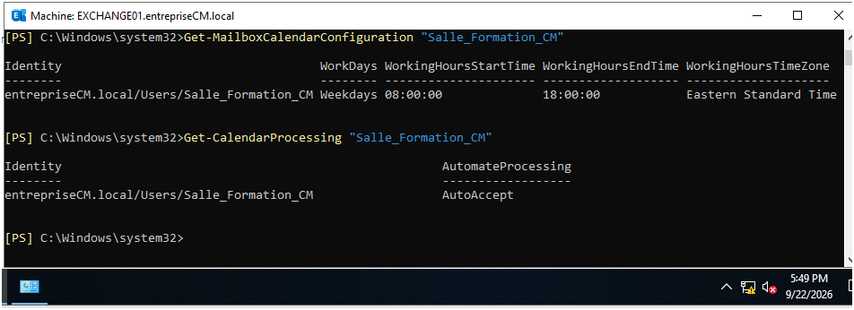

**Test :** dans OWA, avec le compte `professeur`, création d'un événement **un samedi** avec la salle.

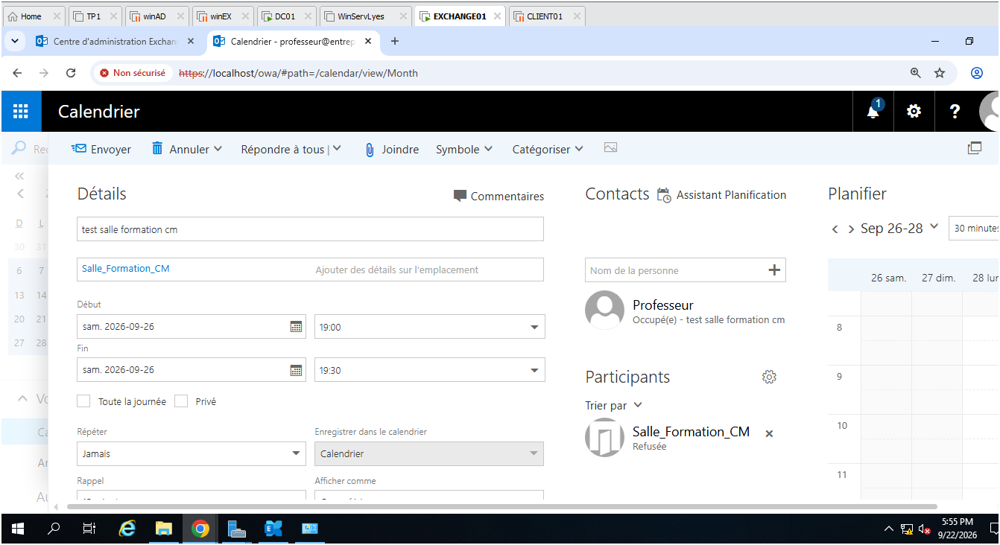

La salle apparaît « Refusée » : c'est le comportement attendu. L'événement reste dans le calendrier de l'organisateur; c'est seulement la salle qui refuse. Le courriel de refus est visible à l'étape 9.

---

## 8. Configuration d'Outlook

CLIENT01 (Windows 11 + Outlook) est créé et joint au domaine.

### 8.1 Profil Outlook pour `etudiant1`

Connexion à Windows avec `etudiant1`, puis ouverture d'Outlook. L'adresse est préremplie : Autodiscover trouve le serveur grâce à AD.

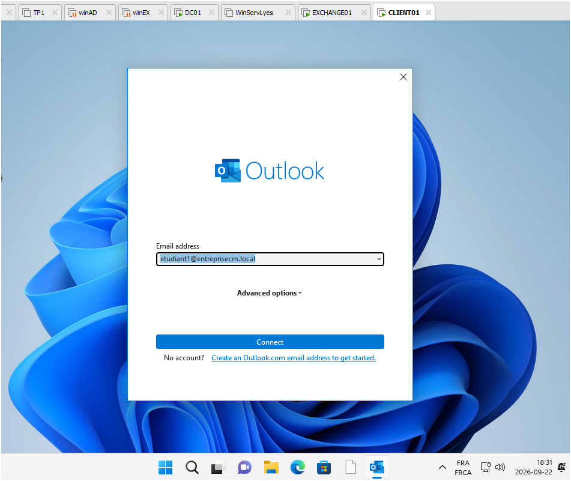

Premier essai : échec.

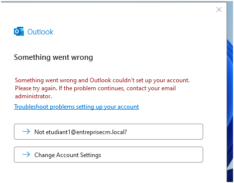

**Diagnostic :** OWA fonctionne dans le navigateur et Autodiscover répond, donc le problème venait du **certificat SSL**. Exchange utilise un certificat auto-signé que le client ne reconnaît pas.

**Solution :** export du certificat d'EXCHANGE01, puis import dans le magasin **Autorités de certification racines de confiance** de CLIENT01.

| | |
|---|---|
| 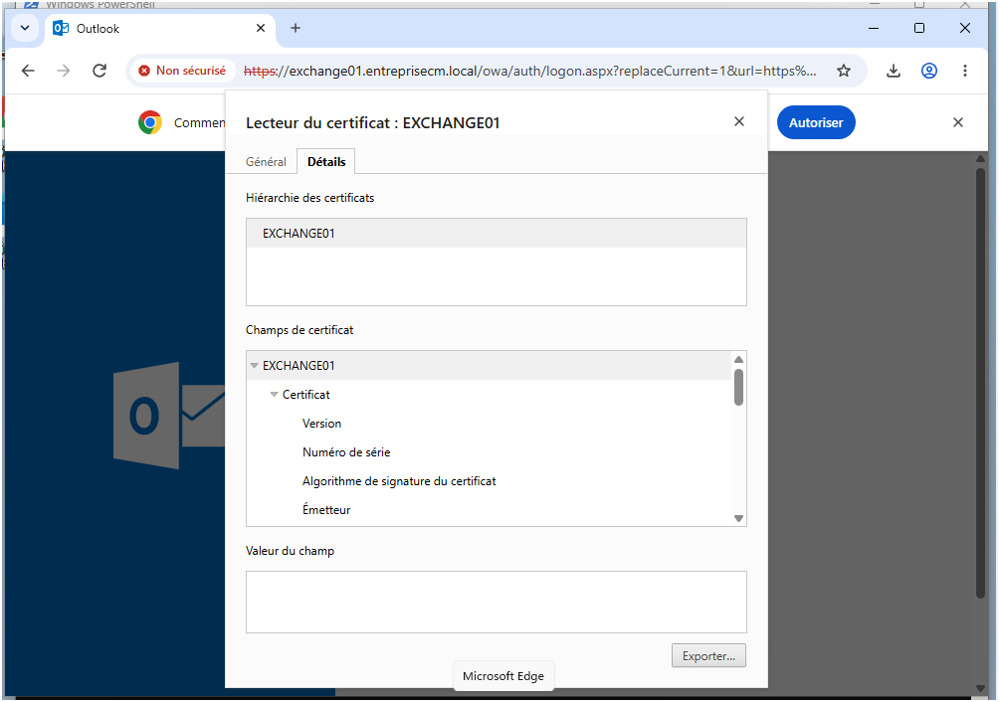 | 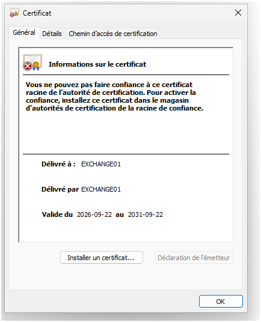 |
| 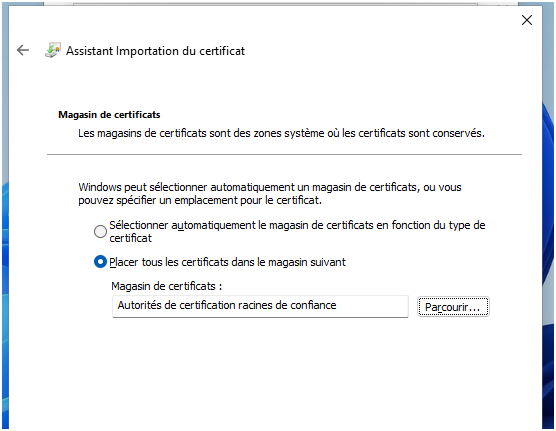 | 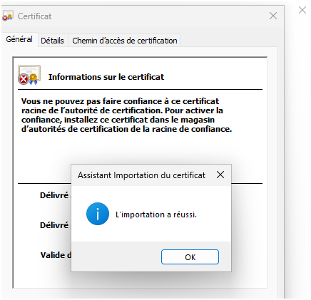 |

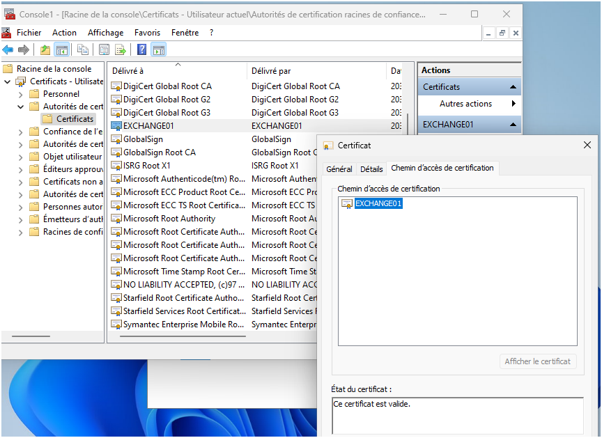

Nouvel essai dans Outlook :

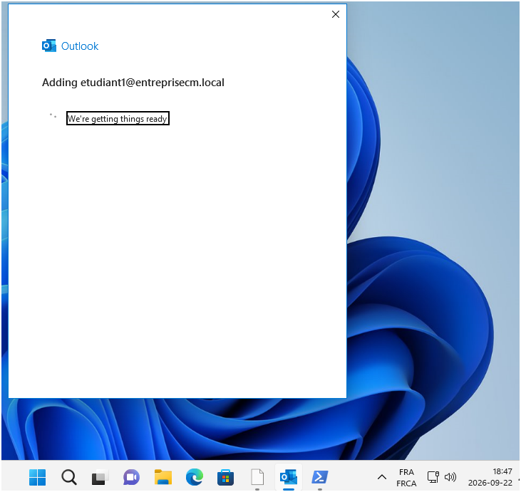

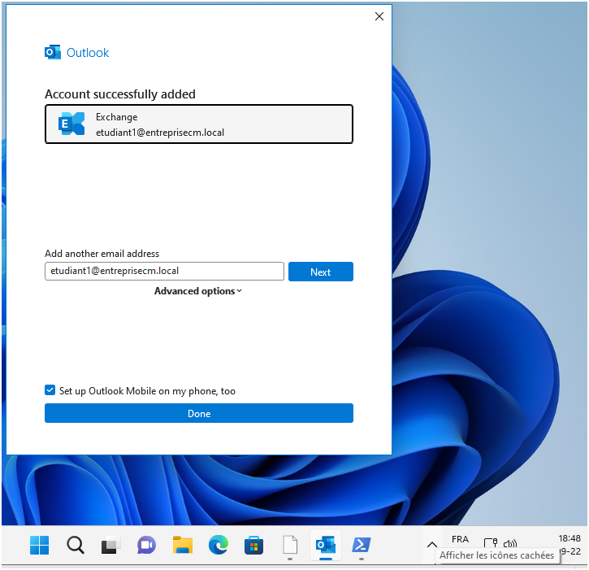

### 8.2 Envoi entre `etudiant1` et `etudiant2`

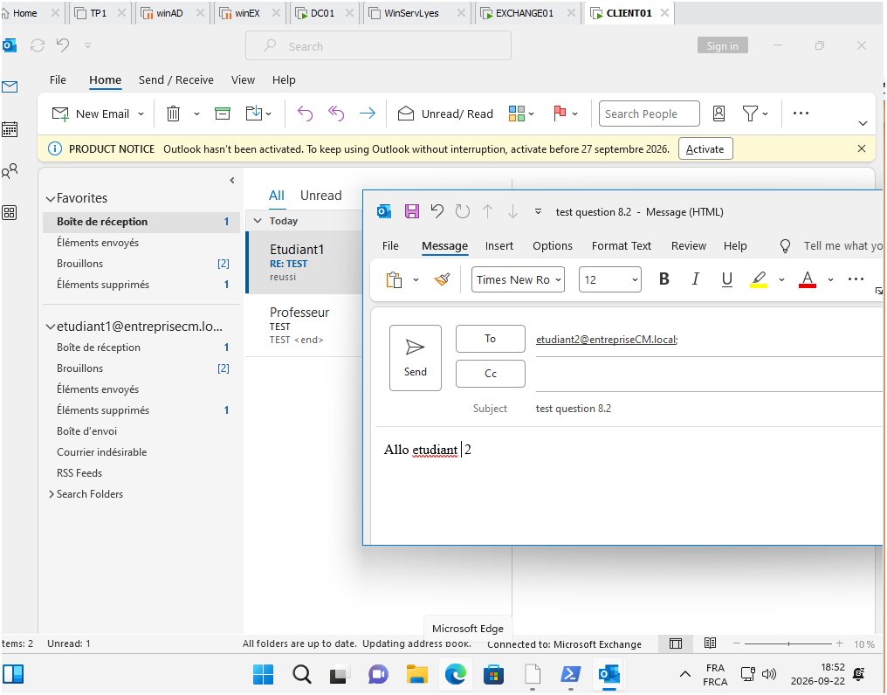

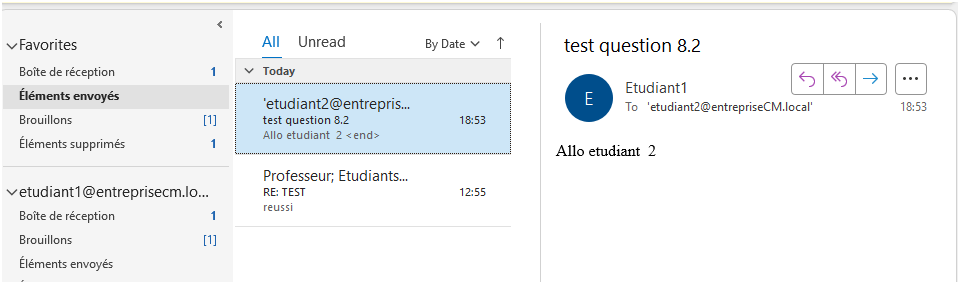

### 8.3 Réception

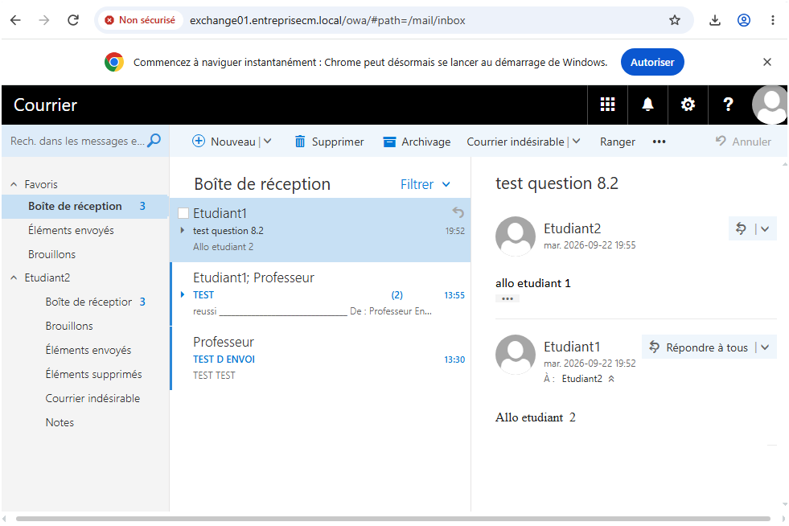


L'échange fonctionne dans les deux sens.

---

## 9. Accès Web (OWA)

Depuis CLIENT01 : `https://exchange01.entreprisecm.local/owa`, connexion avec `etudiant2`, envoi d'un message avec pièce jointe (5 Ko, sous la limite de 1 Mo) au professeur.


On voit aussi le courriel de refus de `Salle_Formation_CM`, qui confirme le test de l'étape 7.

Vérification dans l'EMS :

```powershell
Get-MessageTrackingLog -Sender etudiant2@entrepriseCM.local
```

L'événement **DELIVER** confirme que le message a été livré dans la boîte du destinataire, pas seulement envoyé.


---

## 10. Surveillance des services

### 10.1 État des services Exchange

```powershell
Get-Service | Where-Object {$_.Name -like "*MSExchange*"}
```


Tout ce qui est nécessaire est en cours d'exécution. IMAP et POP3 sont arrêtés : Exchange les installe désactivés par défaut.

`Test-ServiceHealth` va plus loin : il vérifie que les services réellement requis par chaque rôle sont démarrés.


### 10.2 Espace disque et bases de données

```powershell
Get-MailboxDatabase -Status | Select-Object Name, DatabaseSize, AvailableNewMailboxSpace
```

- **`DatabaseSize`** : taille du fichier `.edb` sur le disque.
- **`AvailableNewMailboxSpace`** : espace libre réutilisable à l'intérieur de la base.
- Sans `-Status`, ces colonnes restent vides.


La question demandait aussi l'espace disque, j'ai donc ajouté :

```powershell
Get-Volume
```


On voit `C:` et `E:`, le disque de 40 Go étiqueté *ExchangeDB*.

### 10.3 Files d'attente

```powershell
Get-Queue
```

`MessageCount` est à 0 : tous les messages de test ont été livrés.


---

← [Retour au README](README.md)
